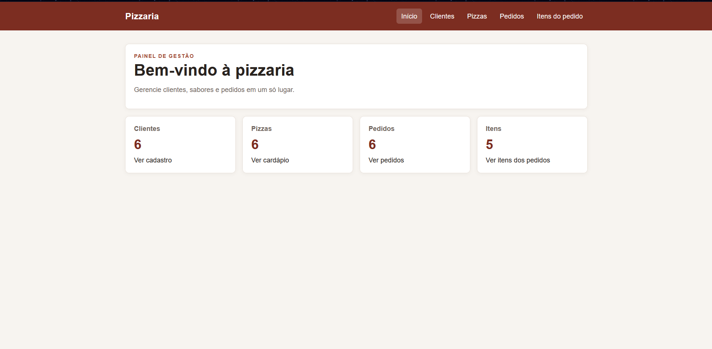
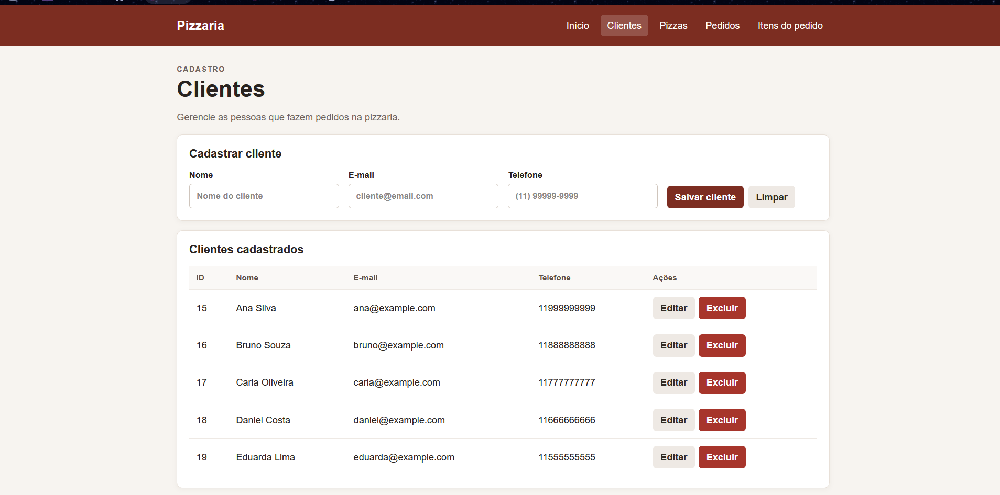
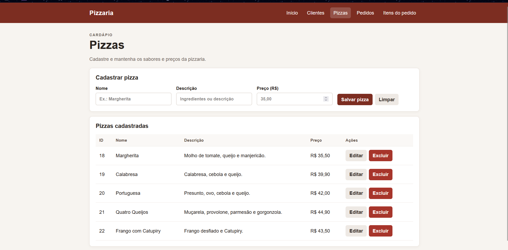
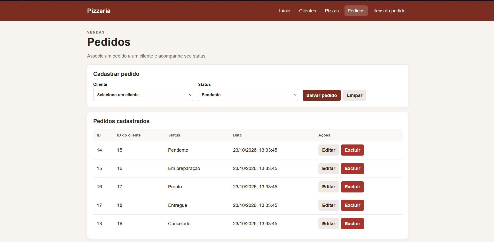
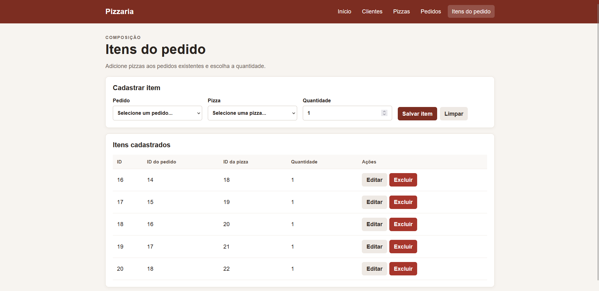

# Prisma-Python

Aplicação local para gerenciar clientes, pizzas, pedidos e itens de pedido. O backend usa FastAPI, Prisma Client Python (Prisma da comunidade - https://prisma-client-py.readthedocs.io/en/stable/)e MySQL; o frontend é feito com HTML, CSS e JavaScript.

## Pré-requisitos

- Windows e CMD.
- Python 3.13 instalado e disponível pelo comando `py`.
- Node.js instalado, necessário para o Prisma CLI.
- XAMPP com o serviço MySQL.
- VS Code (opcional).

# Screenshots

### 1. Home



### 2. Clientes



### 3. Pizzas



### 4. Pedidos



### 5. Itens do pedido




## Banco de dados

1. Inicie o **MySQL** pelo XAMPP Control Panel.
2. Abra `http://localhost/phpmyadmin`.
3. Crie um banco de dados chamado `pizzaria`.
4. No CMD, entre na pasta da API:

   ```cmd
   cd fastAPI
   ```

5. Crie o arquivo `.env` na pasta `fastAPI`.

6. Adicione a URL correspondente ao MySQL do XAMPP. Para a configuração padrão, com o usuário `root` sem senha:

   ```env
   DATABASE_URL="mysql://root:@localhost:3306/pizzaria"
   ```

   Se seu MySQL usar outro usuário, senha ou porta, atualize a URL. Salve o arquivo `.env`.

## Instalar e iniciar o backend

No CMD, ainda dentro de `fastAPI`, crie e ative o ambiente virtual:

```cmd
py -0p
py install 3.13
py -3.13 -m venv .venv
.venv\Scripts\activate.bat
```

Se Python 3.13 já estiver instalado, o comando `py install 3.13` não é necessário.

Instale as dependências especificadas em `fastAPI/requirements.txt`:

```cmd
python -m pip install --upgrade pip
python -m pip install -r requirements.txt
```

Valide o schema, gere o cliente Prisma, crie/atualize as tabelas e inicie a API:

```cmd
prisma validate
prisma generate
prisma db push
uvicorn app:app --reload
```

Mantenha essa janela do CMD aberta enquanto usar o sistema. A documentação interativa da API fica em `http://127.0.0.1:8000/docs`.

## Iniciar o frontend

Com o backend rodando, abra **outra** janela do CMD na pasta principal do projeto. Inicie o servidor web a partir da pasta `web`:

```cmd
cd web
py -3.13 -m http.server 5500
```

Abra `http://127.0.0.1:5500/`. Deixe as duas janelas do CMD e o MySQL do XAMPP em execução. O frontend tem páginas para clientes, pizzas, pedidos e itens do pedido.

## Dados de exemplo

O seed cria cinco registros de cada entidade e relaciona clientes, pedidos e pizzas:

```cmd
cd fastAPI
.venv\Scripts\activate.bat
python prisma\seed.py
```

**Atenção:** o seed apaga primeiro os registros existentes nas tabelas de itens, pedidos, pizzas e clientes. Use-o apenas em um banco local de desenvolvimento/teste.
